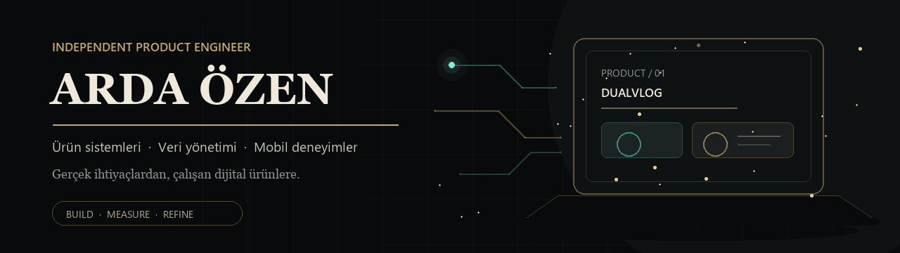

  

  Üretim, operasyon ve gündelik yaşam problemlerini; sade, ölçülebilir ve mağazaya çıkabilen dijital ürünlere dönüştürüyorum.

  SWIFT &amp; SWIFTUI &nbsp;·&nbsp; KOTLIN &amp; ANDROID &nbsp;·&nbsp; .NET &amp; C# &nbsp;·&nbsp; SQL SERVER &amp; FIREBASE

---

## Seçili ürün · DualVlog

**İki kamera. Tek çekim. Daha doğal hikâyeler.** 
Ön ve arka kamerayı aynı anda kullanan DualVlog; kayıt, senkronizasyon ve dışa aktarma akışını içerik üreticileri için tek bir iPhone deneyiminde birleştiriyor.

  <a href="https://apps.apple.com/us/app/dualvlog/id6796005586"><b>App Store’da incele</b></a>
  &nbsp;&nbsp;·&nbsp;&nbsp;
  <a href="https://github.com/ardaaozen/DualVlog"><b>Ürün deposu</b></a>

---

## Mağazadaki ürünler

<table>
<tr>
<td width="50%" valign="top">
  <h3><a href="https://github.com/ardaaozen/NurVaktiIOS">Nur Vakti</a> iOS + Watch</h3>
  
Namaz vakitleri, Kur’an, zikir, widget ve Apple Watch deneyimini tek üründe buluşturur.

  
<a href="https://apps.apple.com/tr/app/nur-vakti-prayer-tasbih/id6758713590">App Store</a> · <a href="https://github.com/ardaaozen/NurVaktiIOS">İncele</a>

</td>
<td width="50%" valign="top">
  <h3><a href="https://github.com/ardaaozen/Nur-Vakti-App">Nur Vakti</a> Android</h3>
  
Günlük ibadet akışını kıble, topluluk, widget ve içerik araçlarıyla destekler.

  
<a href="https://play.google.com/store/apps/details?id=com.ardaozen.nurvakti">Google Play</a> · <a href="https://github.com/ardaaozen/Nur-Vakti-App">İncele</a>

</td>
</tr>
<tr>
<td width="50%" valign="top">
  <h3><a href="https://github.com/ardaaozen/AviTrail-iOS">AviTrail</a> iOS</h3>
  
Kuşları fotoğraf veya sesle tanır; gözlemleri koleksiyona ve yerel liglere dönüştürür.

  
<a href="https://apps.apple.com/br/app/avitrail/id6793438480">App Store</a> · <a href="https://github.com/ardaaozen/AviTrail-iOS">İncele</a>

</td>
<td width="50%" valign="top">
  <h3><a href="https://github.com/ardaaozen/MiraKnit">MiraKnit</a> iOS</h3>
  
Modern örgü tariflerini, adım adım dersleri ve kişisel proje arşivini birleştirir.

  
<a href="https://apps.apple.com/es/app/miraknit/id6793510512">App Store</a> · <a href="https://github.com/ardaaozen/MiraKnit">İncele</a>

</td>
</tr>
<tr>
<td width="50%" valign="top">
  <h3><a href="https://github.com/ardaaozen/FacetPDF-Studio-Showcase">FacetPDF Studio</a> iOS + iPadOS</h3>
  
PDF okuma, düzenleme, tarama ve dönüştürme araçlarını cihaz üzerinde çalışan bir stüdyoda toplar.

  
<a href="https://apps.apple.com/us/app/facetpdf-studio/id6793311006">App Store</a> · <a href="https://github.com/ardaaozen/FacetPDF-Studio-Showcase">İncele</a>

</td>
<td width="50%" valign="top">
  <h3><a href="https://github.com/ardaaozen/DualVlog">DualVlog</a> iOS</h3>
  
Ön ve arka kamerayı senkron kaydederek içerik üretimini tek çekimlik bir akışa indirger.

  
<a href="https://apps.apple.com/us/app/dualvlog/id6796005586">App Store</a> · <a href="https://github.com/ardaaozen/DualVlog">İncele</a>

</td>
</tr>
</table>

## Ürün ve operasyon sistemleri

<table>
<tr>
<td width="50%" valign="top">
  <h3><a href="https://github.com/ardaaozen/PusulaAkademi-Showcase">Pusula Akademi</a></h3>
  
Öğrenci, akademik süreç ve finans operasyonları için .NET, WPF ve SQL Server tabanlı yönetim sistemi.

</td>
<td width="50%" valign="top">
  <h3><a href="https://github.com/ardaaozen/aymali-aluminyum-erp-tanitim">Aymalı Alüminyum ERP</a></h3>
  
Tekliften üretime, stoktan finansa uzanan saha odaklı masaüstü operasyon sistemi.

</td>
</tr>
<tr>
<td width="50%" valign="top">
  <h3><a href="https://github.com/ardaaozen/verimium-app">Verimium</a></h3>
  
Tarla, hayvancılık, finans, uydu verileri ve yapay zekâ içgörülerini bir araya getiren tarım platformu.

</td>
<td width="50%" valign="top">
  <h3><a href="https://github.com/ardaaozen/merasim-showcase">Merasim</a></h3>
  
Özel anları hareketli ve paylaşılabilir davetiyelere dönüştüren SwiftUI tasarım stüdyosu.

</td>
</tr>
<tr>
<td width="50%" valign="top">
  <h3><a href="https://github.com/ardaaozen/drink-journal">Drink Journal</a></h3>
  
İçecekleri, alkolsüz günleri ve anıları kişisel bir takvimde kaydeden iPhone günlüğü.

</td>
<td width="50%" valign="top">
  <h3><a href="https://github.com/ardaaozen/MyCombine">MyCombine</a></h3>
  
Dijital dolap, yapay zekâ destekli kombin planlama ve bilinçli alışveriş için kişisel stil asistanı.

</td>
</tr>
</table>

---

  Ürün mühendisliği &nbsp;·&nbsp; Mobil geliştirme &nbsp;·&nbsp; Operasyon sistemleri &nbsp;·&nbsp; Veri odaklı karar desteği

