  

  Üretim, operasyon ve gündelik yaşam problemlerini; sade, ölçülebilir ve mağazaya çıkabilen dijital ürünlere dönüştürüyorum.

  SWIFT &amp; SWIFTUI &nbsp;·&nbsp; KOTLIN &amp; ANDROID &nbsp;·&nbsp; .NET &amp; C# &nbsp;·&nbsp; SQL SERVER &amp; FIREBASE

---

## Yayındaki uygulamalar

<table>
<tr>
<td width="50%" valign="top">

<h3><a href="https://github.com/ardaaozen/NurVaktiIOS">Nur Vakti · iOS + Watch</a></h3>

Namaz vakitleri, Kur’an, zikir, widget ve Apple Watch deneyimi.

</td>
<td width="50%" valign="top">

<h3><a href="https://github.com/ardaaozen/Nur-Vakti-App">Nur Vakti · Android</a></h3>

Namaz vakitleri, kıble, zikir ve günlük manevi içerikler.

</td>
</tr>
<tr>
<td width="50%" valign="top">

<h3><a href="https://github.com/ardaaozen/DualVlog">DualVlog</a></h3>

Ön ve arka kamerayla tek çekimde çift perspektifli video üretimi.

</td>
<td width="50%" valign="top">

<h3><a href="https://github.com/ardaaozen/AviTrail-iOS">AviTrail</a></h3>

Kuşları fotoğraf ve sesle tanı; gözlemlerini koleksiyona dönüştür.

</td>
</tr>
<tr>
<td width="50%" valign="top">

<h3><a href="https://github.com/ardaaozen/merasim-showcase">Merasim</a></h3>

Özel anlar için hareketli, paylaşılabilir davetiyeler tasarla.

</td>
<td width="50%" valign="top">

<h3><a href="https://github.com/ardaaozen/drink-journal">Drink Journal</a></h3>

İçecekleri, alkolsüz günleri ve anıları özel bir günlükte tut.

</td>
</tr>
<tr>
<td width="50%" valign="top">

<h3><a href="https://github.com/ardaaozen/FacetPDF-Studio-Showcase">FacetPDF Studio</a></h3>

PDF okuma, düzenleme, tarama ve imzalama çalışma alanı.

</td>
<td width="50%" valign="top">

<h3><a href="https://github.com/ardaaozen/MiraKnit">MiraKnit</a></h3>

Örgü dersleri, modern tarifler ve kişisel proje arşivi.

</td>
</tr>
</table>

## Web ve ürün sistemleri

<table>
<tr>
<td width="50%" valign="top">

<h3><a href="https://github.com/ardaaozen/NurVakti-Web-Showcase">Nur Vakti · Web</a></h3>

Mobil ürünleri ve dini bilgi arşivini web deneyiminde buluşturur.

  

</td>
<td width="50%" valign="top">

<h3><a href="https://github.com/ardaaozen/PusulaAkademi-Showcase">Pusula Akademi</a></h3>

Öğrenci, akademik süreç ve finans operasyonları için masaüstü ERP.

<a href="https://github.com/ardaaozen/PusulaAkademi-Showcase">Projeyi incele →</a>

</td>
</tr>
<tr>
<td width="50%" valign="top">

<h3><a href="https://github.com/ardaaozen/aymali-aluminyum-erp-tanitim">Aymalı Alüminyum ERP</a></h3>

Tekliften üretime, stoktan finansa saha odaklı operasyon sistemi.

<a href="https://github.com/ardaaozen/aymali-aluminyum-erp-tanitim">Projeyi incele →</a>

</td>
<td width="50%" valign="top">

<h3><a href="https://github.com/ardaaozen/verimium-app">Verimium</a></h3>

Tarım, hayvancılık, finans ve uydu verileri için mobil platform.

<a href="https://github.com/ardaaozen/verimium-app">Projeyi incele →</a>

</td>
</tr>
<tr>
<td width="50%" valign="top">

<h3><a href="https://github.com/ardaaozen/MyCombine">MyCombine</a></h3>

Dijital dolap ve yapay zekâ destekli kombin planlama.

<a href="https://github.com/ardaaozen/MyCombine">Projeyi incele →</a>

</td>
<td width="50%"></td>
</tr>
</table>

---

  Ürün mühendisliği &nbsp;·&nbsp; Mobil geliştirme &nbsp;·&nbsp; Operasyon sistemleri &nbsp;·&nbsp; Veri odaklı karar desteği

